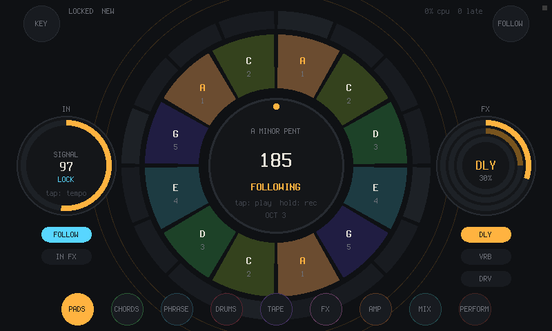

# RING

A round touch instrument for a Raspberry Pi 4 and its 7-inch touchscreen. It listens to the music coming in, locks
its clock to the beat, and lets you play along on top.



**[Try it on your computer](#try-it)** · [Project page](https://willbearfruits.github.io/ring/) ·
[The design sheet](https://willbearfruits.github.io/ring/design/sheet.html) · [Get one](#get-one)

Plug a drum machine, a band or a record into it. RING hears the tempo and where the bar starts, and what you play
on the screen lands in time: pads in the key, chords to strum, drums, tape loops, effects. Every page is a ring:
tap to play, drag along a ring to strum or set an amount, turn the middle to transpose.

## What it does

- **Follows the beat**: it listens to the input, finds the tempo, the beat and the downbeat, and locks to them. Tap
  tempo, nudge and downbeat are there when you want to lead.
- **Pads and chords in the key**: twelve scale pads around the middle; the seven chords of the key on a
  thirteen-string strum ring, with harp, organ and pad voices. HEAR KEY tells you the key of what's coming in.
- **Drums, phrases and tape**: twelve synthesized drums with eight patterns, four melody phrases, four loop layers
  that stay on the bar.
- **Effects and an amp**: delay and gate on the clock, reverb, drive, an amp with six voicings and a tuner. PERFORM
  has repeat, stutter, tape stop, freeze and kills to play live.
- **Modulation without a grid**: tap a source (two LFOs, the beat, the input level, your finger), then a target.
- **Plays with other gear**: MIDI in and out (it connects to every MIDI device it finds: notes, clock, start and
  stop), and Ableton Link for tempo and phase over the network.
- **Keeps your work**: twelve project slots, twelve scenes, undo, autosave, and the output bounced to WAV.

## Get one

RING is software; there is nothing to order. You put it on parts you can buy:

- a **Raspberry Pi 4** and its USB-C power supply,
- the **official Raspberry Pi 7-inch touchscreen** (the 800 × 480 one, on the DSI ribbon),
- a **USB audio interface with an input**, so RING has something to hear. [TWOFOLD](https://github.com/willbearfruits/twofold)
  is the matching one, an ESP32-S3 interface by the same maker: the Pi image picks it up by itself. Any
  class-compliant USB interface works too, and so does a codec HAT on the GPIO header
  ([pi/README.md](pi/README.md)),
- a **microSD card** of 8 GB or more.

TWOFOLD is built by hand in Haifa. Ask about one: [Dogme84@gmail.com](mailto:Dogme84@gmail.com?subject=TWOFOLD) or
[WhatsApp](https://wa.me/972539263808).

## Try it

On a Linux computer first: the same instrument in a window, with the mouse as one finger.

```
sudo apt install build-essential libsdl2-dev libasound2-dev     # Debian, Ubuntu, Raspberry Pi OS
sudo pacman -S base-devel sdl2-compat alsa-lib                  # Arch
git clone https://github.com/willbearfruits/ring
cd ring
make run
```

It opens the default audio input and output; play something into the input and watch FOLLOW lock. `F1`..`F8` jump
between pages, `F11` is full screen, `Esc` quits. `RING_IN` and `RING_OUT` pick other audio devices (the log lists
the inputs).

Then on the Pi. A ready image will go on the Releases page once it has been played on a Pi; until then, build it
(on Linux with Docker and qemu-user-static for arm64; about half an hour the first time):

```
make image                                   # -> build/pi/ring-pi4.img.xz
xz -dc build/pi/ring-pi4.img.xz | sudo dd of=/dev/sdX bs=4M status=progress   # lsblk names the card
```

Or write it with [Raspberry Pi Imager](https://www.raspberrypi.com/software/) (*Use custom*). Connect the
touchscreen and the audio interface, power it up, and it starts straight into RING. Login, settings, a codec HAT
and installing by hand on a stock Raspberry Pi OS: [pi/README.md](pi/README.md).

## Status

Early, and this is exactly where it stands:

- **It works on a Linux desktop.** It builds without warnings, runs, and passes its headless checks (`make test`):
  every page draws; pads, chords, drums and tape sound; the follower locks to five drum loops of known tempo;
  projects save and load back identical; MIDI clock goes out; Link joins the network.
- **The Pi image builds.** `make image` makes a Raspberry Pi OS Lite image that starts into RING.
- **On the Pi itself it is being tested now**, with the touchscreen and a sound card. Until that's done, treat the
  Pi side as untested.
- The follower can settle on half or double the tempo: in the checks, a loop at 128 BPM is heard as 64.
- The AMP page has a slot for NAM captures; they aren't in yet.

## Pages (0.3)

Every page is a ring in its own colour. The play pages sit on the bottom edge, the utilities behind the two top
corners (KEY on the left, FOLLOW on the right), and a swipe down from the top locks the stage. The full screen
sheet is [docs/design/sheet.html](docs/design/sheet.html) ([open it](https://willbearfruits.github.io/ring/design/sheet.html));
[mockup.html](docs/design/mockup.html) is the first sketch that made sound.

- **PADS**: twelve scale pads coloured by degree, tap or strum, root at 12 o'clock; turn the hub to transpose, tap it
  to play or stop, hold it to record. Left disc: input level, follow confidence, FOLLOW and IN FX. Right disc: the
  selected effect's amount.
- **CHORDS**: the seven chords of the key plus sevenths and a sus, a thirteen-string strum ring, harp, organ or pad
  voice, HOLD, octave.
- **PHRASE**: four phrases as nested arcs, tap steps, REC writes what you play, odd lengths.
- **DRUMS**: twelve synthesized drums (the PSX DRUMS kit), eight patterns of sixteen steps with ghost, normal and
  accent levels, record by playing, pitch and decay per drum, DIRT.
- **TAPE**: four loop layers synced to the bar, 1 to 8 bars, overdub, half and double speed, reverse, undo.
- **FX**: twelve amounts on the outer ring: delay, reverb, drive, gate, feedback, size, swing, the voice's attack,
  release, FM and sub, the gate division. Delay and gate follow the clock.
- **MIX**: every bus as a fader arc around the master meter.
- **PERFORM**: hold for repeat, stutter, tape stop, freeze, kill low, kill high, half and double time, FILTER,
  REVERSE, MUTE IN and SOLO IN; the hub kills.
- **AMP**: the input through a gain stage, tone stack, asymmetric clipper and cabinet in six voicings (CLEAN,
  CRUNCH, FUZZ, BASS, PLEXI, BROKEN), gain, tone, level and presence as four quadrants of the outer ring, a tuner
  on the left disc. NAM captures are the planned next step; the slot is there.
- **ROUTING**: the chain as discs, amp and effects on the input, what the tape records, what the follower hears
  (the input or the mix), MIDI, and Ableton Link on or off.
- **MOD**: a modulation matrix without a grid: sources on the inner ring (two LFOs, input level, beat, bar, touch X
  and Y, random per beat, follow confidence), targets on the outer (pitch, cutoff, delay, reverb, drive, gate, master,
  FM, tape level, delay feedback, swing); tap a source then a target, the line between them is the link.
- **KEY**: circle of fifths, six scales, octave, and HEAR KEY: the key the input is in, from a chroma against
  Krumhansl's profiles, with LISTEN to follow it live.
- **SONG** (twelve entries of pattern, phrases and repeats), **FILE** (twelve project slots on the card, SAVE, SAVE
  AS with a ring keyboard, LOAD, NEW), **SCENES** (twelve snapshots of the whole document), **UNDO** (every change
  as a tick on the ring).
- **FOLLOW** (the listener), **SETUP** (audio path, latency, CPU, late blocks, bounce to WAV), **NOTICES** (the
  log), **HELP**, **STAGE** (locked: the beat, four pads, kill), **BOOT**.

Around the pages:

- **MIDI** in and out over the ALSA sequencer: notes play the pads; clock and start/stop drive the sequencer; the
  pads, phrase, chords and drums go out as notes with clock and transport.
- **Ableton Link** (BARE!'s implementation, ported) shares tempo, phase and start/stop with Live and the others on
  the network.
- Projects autosave on quit and reload at boot. Bounces land in `BOUNCE/` on the card folder (`build/card/` on the
  desktop, `/var/lib/ring/` on the Pi image).

## The follower

`core/follow.c`: a log-energy onset function at 375 Hz (128-sample hops, high-frequency emphasis), smoothed by a
5 ms gaussian, autocorrelated over the last 5.5 seconds twice a second; each candidate tempo is scored with a comb
over its multiples and a soft prior for 95-165 BPM, the faster octave wins when it scores nearly as well. The beat
phase is the comb offset that lines up with the recent onsets; the downbeat is the strongest of four beats.

`make test` checks it against loops of known tempo rendered for PSX DRUMS, the PlayStation drum machine. It looks
for them in `../lsdj/psx-drums/pack/`, beside this folder; without them those five checks print `skip` and the rest
still run.

## Building and running

```
make            # build/ring: the instrument in a window
make run        # RING_KIOSK=1 for full screen 800x480 with no cursor (the Pi)
make test       # headless checks -> build/out/: page renders (ppm), touch.wav, drums.wav, follow accuracy
make image      # build/pi/ring-pi4.img.xz: Raspberry Pi OS Lite with RING, for a Pi 4 (Docker)
```

Needs a C11 compiler, SDL2 and ALSA. Environment: `RING_IN` / `RING_OUT` name SDL audio devices (the log lists the
inputs), `RING_BUFFER` the frames per block (128), `CARD` the folder projects and bounces go to (`build/card`).
Keys in the window: `Esc` quits, `F11` full screen, `F1`..`F8` jump to pages. The mouse works as one finger; a
touchscreen gives ten.

The Pi: [pi/README.md](pi/README.md) covers the image, the audio device it picks (a TWOFOLD when one is plugged in,
else the first USB audio card, else a codec HAT), settings, latency and installing by hand.

## Layout

```
core/   plain C11: doc (the document, projects), eng (audio thread), follow, key (chroma, tuner), amp, voice,
        drums, tape, fx, link (Ableton Link, from BARE!), ui (pages), ring (polar rasterizer), gfx + fonts + lib +
        dsp (from the R36S rhythm machine)
host/   SDL2 window and audio, ALSA MIDI, UDP for Link, plat for Linux
test/   headless checks (make test)
pi/     the Pi image (mkimage.sh, image/), an install script for a stock Raspberry Pi OS, notes
docs/   the project page, its pictures, and the design sheets (docs/design/)
```

Linux first (SDL2), bare metal later: the core only talks to the machine through `core/plat.h` and the host.

## Next

Run it on the Pi with the panel and a sound card ([pi/README.md](pi/README.md)), NAM captures into the AMP slot,
then a bare-metal host on Circle.

## Where the code comes from

RING reuses its maker's earlier work: Ableton Link from [BARE!](https://github.com/willbearfruits/bare), the drawing,
fonts and DSP blocks from the [R36S rhythm machine](https://github.com/willbearfruits/r36s-rhythm), and the drum kit
from PSX DRUMS. Its sound card of choice is [TWOFOLD](https://github.com/willbearfruits/twofold).

## License

RING is free software: GPL-3.0-or-later ([LICENSE](LICENSE)). It draws its text with the Terminus font (SIL Open
Font License 1.1); [NOTICE.md](NOTICE.md) has the details and the credits.

---
Part of [Serious S.H.I.T.](https://willbearfruits.github.io/): instruments, tools and workshops made in Haifa by
Yaniv Schonfeld (Willbear). If this is useful to you, [support it on Patreon](https://www.patreon.com/Seriousshit).
